# UIFormElements.js

> **The version 0.8b is still in its beta state. Some attributes are not implemented. The library can be used for basic applications or educational tasks, such as prototyping, testing, learning, research or quick development.** 

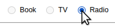

**This is a legacy-compatible HTML Form toolkit for prototyping or web-applications with simple form-elements.**

It is sucessfully tested with Firefox 25 and Chromium 70 on Linux x64.

> Check out the live-editor: https://nowca.github.io/uiformelements.js/development/live-editor/UILiveEditor.html

<br>

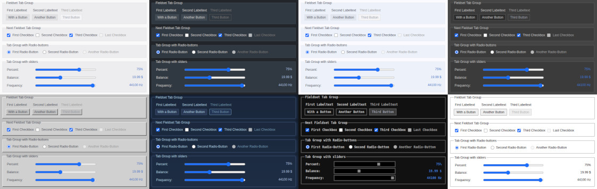

<br>

**Contents**

- [Usage and examples](#usage-and-examples)
- [Forms with HTML: Declarative HTML initialization](#declarative-html-initialization)
- [Forms with JavaScript: Procedural JavaScript instructions](#procedural-javascript-instructions)
- [Form-Element-objects and attributes](#form-element-objects-and-attributes)
    - [Button](#button)
    - [Checkbox](#checkbox)
    - [DropdownList](#dropdownlist)
    - [Label](#label)
    - [RadioButton](#radiobutton)
    - [Seperator](#seperator)
    - [Slider](#slider)
    - [TextArea](#textarea)
    - [TextInput](#textinput)
- [Group-objects](#group-objects)
    - [Group](#group)
    - [Tab](#tab)
    - [Form](#form)
- [Options](#options)
    - [Themes](#themes)
- [UICodeConsole.js extension](#uicodeconsolejs-extension)
    - [Initialization](#initialization)
    - [Configuration options](#configuration-options)
    - [HTML and CSS export](#html-and-css-export)
- [Buiding production files](#buiding-production-files)
    - [Node.js Linker and compressor](#nodejs-linker-and-compressor)
    - [Configuration and setup](#configuration-and-setup)
- [Development sources](#development-sources)
- [License](#license)
    - [Third-party software](#third-party-software)

<br>


## Usage and examples

**There are two methods to use the script:**

> - **Forms with HTML:** Declarative HTML initialization

and:

> - **Forms with JavaScript:** Procedural JavaScript instructions

<br>


- **Declarative HTML example elements, with JS initialization:**

> `/production/examples/example-declarative.html` 

- **Procedural JS example elements:**

> `/production/examples/example-procedural.html`

- **Application example with a calculator using JS-`eval()`:**

> `/production/examples/example-calculator-export.html`

- **UICodeConsole.js-extension example, for exporting the generated form as static HTML:**

> `/production/examples/examples-with-code-console.html`


<br>

## Forms with HTML: Declarative HTML initialization


Write a container-DIV node with its element-id and its contents and the HTML-attributes:

```html 
<div class="Layout" id="main-container">
    <div class="Tab" id="tab-group-1" title="Fieldset Tab Group">
    	<div class="Group" inline=true>
    		<div class="Label" id="label-1" inline=false>Labeltext</div>
    		 <div class="Button" id="button-1">OK</div>
    	</div>
    <div class="Tab" id="tab-group-2" title="Next Fieldset Tab Group">
        <div class="Checkbox" id="checkbox-1">First Checkbox</div>
        <div class="Checkbox" id="checkbox-2">Second Checkbox</div>
    </div>
    <div class="Tab" id="tab-group-3" title="Tab Group with Radio-buttons">
        <div class="RadioButton" id="radiobutton-1" name="radio-group">First Radio-Button</div>
        <div class="RadioButton" id="radiobutton-2" name="radio-group">Second Radio-Button</div>
    </div>
    <div class="Tab" id="tab-group-4" title="Tab Group with Sliders">
        <div class="Slider" id="ui-slider-1" min=0, max=100 value=75 step=1 inline=true></div>
        <div class="Label Value" bind="ui-slider-1" style="float: right;">{value}%</div>
    </div>
    <div class="Tab" id="tab-group-5" title="Tab Group with Lists">
        <div class="Label">Simple selection list:</div>
        <div class="DropdownList" id="dropdown-1" values="[entry-1, entry-2, entry-3]"></div>
        <div class="Label">Multiple selection list:</div>
        <div class="DropdownList" id="dropdown-2" multiple="true" values="[entry-1, entry-2, entry-3]"></div>
        
    </div>
    <div class="Tab" id="tab-group-5" title="Tab Group with Textfields">
        <div class="TextArea" id="textarea-1" rows="5" cols="30" placeholder="Placeholder text" style="resize: none"></div>
        <div class="TextInput" id="text-input-1" placeholder="Type in something" inline=true></div>
        <div class="Label Value" bind="text-input-1">Text: {value}</div>
    </div>
</div>

<div id="parent-root-node"></div>

```

<br>

→ and initialize it with the command:

```javascript 
UIFormElements.init("main-container");
```
→ or optional with a root-node to append the generated form to as a child-element:

```javascript 
var parentRootNode = document.getElementById("parent-root-node")
UIFormElements.init("main-container", parentRootNode);
```

> - the id of the container DIV-element
> - (optional) the HTML node to append the generated code, otherwise it will be appended on `document.body`

**The HTML code will be transformed and replaced into compatible HTML code.**

<br>

> The `TEMPLATE`-tag can be used (instead the `DIV`-tag), to hide the draft node-tree from the documents rendered page in the browser window.


<br>

## Forms with JavaScript: Procedural JavaScript instructions

Example:

```javascript 
var uiGroup = UIGroup().add([
	UIGroup().add([
	    UILabel({ id: "user-name", text: "Username: ", style: labelWidth }),
	    UITextInput({ placeholder: "Type in the username", size: 12, name: "username" })
	]),
	UIGroup().add([
	    UILabel({ id: "email-address", text: "E-Mail: ", style: labelWidth }),
	    UITextInput({ placeholder: "Type in the e-mail", size: 12, name: "email" })
	]),
	UIGroup().add([
	    UILabel({ id: "password", text: "Password: ", style: labelWidth }),
	    UITextInput({ id: "password-field", placeholder: "Type in the password", size: 12, name: "password", type: "password" }),
	    UICheckbox({ id: "showpass", text: "Show password", onchange: "showPassword()" })
	])
]);

var uiGroupHtmlElement = uiGroup.createHTMLElement();

document.body.appendChild(uiGroupHtmlElement);
```
<br>

All Objects contain the basic options:
```javascript
{ id: "<string>", class: "<string>", name: "<string>", style: "<string>", disabled: "<boolean>" }
```

→ and some basic event handlers: `onblur, onchange, oncontextmenu, onfocus, onclick, oninput, oninvalid, onreset, onsearch, onselect, onsubmit`

```javascript
{ onclick: "<string>" }
```

<br>

## Form-Element-objects and attributes

There are several UI-Objects, for working with HTML Form-elements, that can be used.

> All UI-Objects contain the `.createHTMLElement(<attributes>)` function, to get a returned HTML node with its attributes from the UI Object or new attributes.

You can read more about HTML Form Elements and their attributes at [W3CSchools](https://www.w3schools.com/html/html_form_elements.asps)


### All basic-element-attributes

Every element has its basic attributes and event-handlers:

> JavaScript:

```javascript 
UI...({
    id: "<string>",
    class: "<string>",
    name: "<string>",
    style: "<string>",
    disabled: "<boolean>"
})
```

> HTML:

```html 
<div id="..." class="Element" name="..." style="color: blue;" disabled=true></div>
```

#### Generate hashed element Id

```html 
<div id="<generateId>" class="Element" name="..." style="color: blue;" disabled=true></div>
```

<br>

### Button

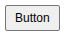

> JavaScript:

```javascript 
UIButton({
    text: "<string>",
    type: "<string>"
})
```

> HTML:

```html 
 <div class="Button">text</div>
```

<br>

### Checkbox


> JavaScript:

```javascript 
UICheckbox({
    text: "<string>",
    value: "<value>",
    checked: "<boolean>"
})
```

> HTML:

```html 
<div class="Checkbox"></div>
```

<br>

### DropdownList

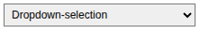

> JavaScript:

```javascript 
UIDropdownList({
    values: "<array>",
    size: "<number>",
    multiple: "<boolean>",
    selected: "<value>"
})
```

> HTML:

```html 
<div class="DropdownList" values="[item-1, item-2, item-3]"></div>
```

<br>

### Label

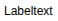

> JavaScript:

```javascript 
UILabel({
    text: "<string>",
    name: "<string>",
    value: "<value>",
    bind: "<string>"
})
```

> HTML:

```html 
 <div class="Label">text</div>
```

<br>

### RadioButton


> JavaScript:

```javascript 
UIRadioButton({
    text: "<string>",
    name: "<string>",
    value: "<value>",
    checked: "<boolean>"
})
```

> HTML:

```html 
<div class="RadioButton" name="radio-group">A</div>
<div class="RadioButton" name="radio-group">B</div>
<div class="RadioButton" name="radio-group">C</div>
```

<br>

### Seperator


```javascript 
UISeperator()
```

<br>

### Slider


> JavaScript:

```javascript 
UISlider({
    value: "<number>",
    min: "<number>",
    max: "<number>",
    step: "<number>"
})
```

> HTML:

```html 
<div class="Slider" id="ui-slider" min=0, max=100 value=75 step=1 inline=true></div><div class="Label Value" bind="ui-slider">{value}</div>
```

<br>

### TextArea

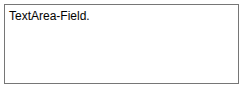

> JavaScript:

```javascript 
UITextArea({
    text: "<string>",
    rows: "<number>",
    cols: "<number>",
    placeholder: "<string>"
})
```
> HTML:

```html 
<div class="TextArea" rows="5" cols="30" placeholder="Placeholder text" style="resize: none"></div>
```

<br>

### TextInput

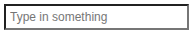

> JavaScript:

```javascript 
UITextInput({
    text: "<string>",
    name: "<string>",
    value: "<string>",
    placeholder: "<string>",
    type: "<string>",
    min: "<number>",
    max: "<number>",
    maxlength: "<number>",
    pattern: "<string>",
    readonly: "<boolean>",
    size: "<number>"
})
```
> HTML:

```html 
<div class="TextInput" placeholder="Type in something"></div>
```

<br>

## Group-objects

Group-objects can be used to group other elemental or group objects and display them in a container or form-element, like fieldset.

> All group-objects contain the `.add([<UIElement>, ...])` function to add them into the group-object.

<br>

### Group

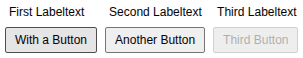

> JavaScript:

```javascript 
UIGroup({ <attributes> })
```

> HTML:

```html 
 <div class="Group" inline=true>
     ...
 </div>
```

<br>

### Tab

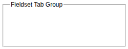

> JavaScript:

```javascript 
UITab({ <attributes> })
```

> HTML:

```html 
<div class="Tab" title="Tab title">
    ...          
</div>
```

<br>

### Form

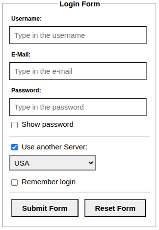

> JavaScript:

```javascript 
UIForm({ <attributes> })
```
The same attributes like in the `HTML <form> Tag`

> HTML:

```html 
<form class="Form" action="" method="get">
    ...          
</form>
```

Write a container-DIV node with its element-id and its contents and the HTML-attributes:

<br>

## Options

You can set some options with the command:

```javascript 
UIFormElements.setConfig({
    userselect: false,      // switch off user-selection with the command
    theme: "SystemUIDark"   // set the color-theme
});
```
### Themes

You can also set the theme with the configuration or the following command:

```javascript
UIFormElements.changeTheme("SystemUI");
```

**Available themes:**

- **None**

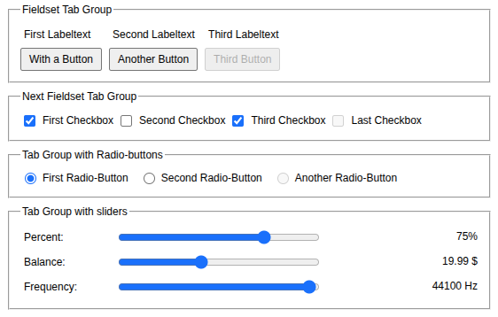

- **SystemUI**

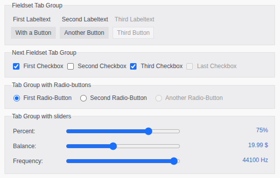

- **SystemUIDark**

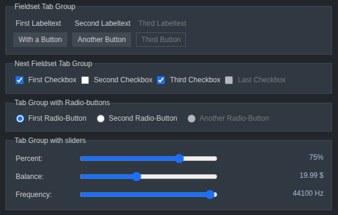

- **Chromium**

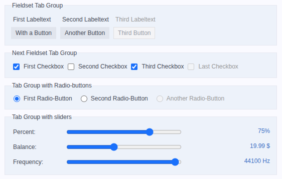

- **Gimp**

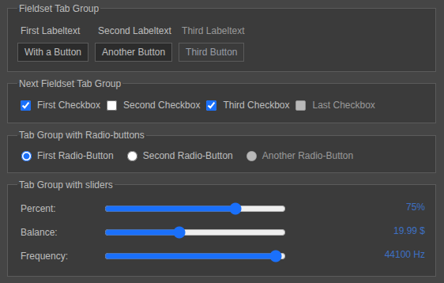

- **WindowsClassic**

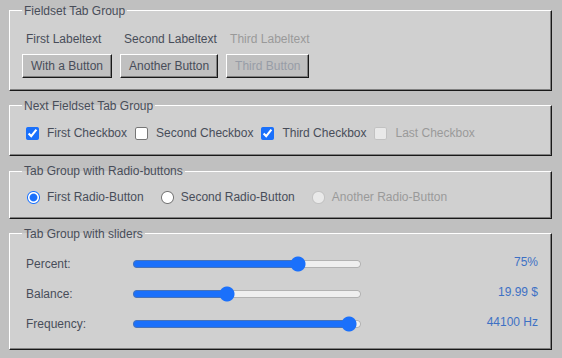

- **DeepBlue**

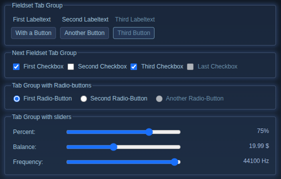

- **Terminal**

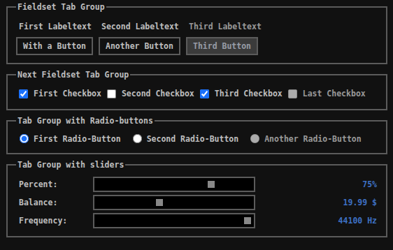

- **Custom**

Use the custom template to create own color-themes

<br>

## UICodeConsole.js extension

The extension can be used to export the generated HTML/JS and CSS sourcecode into exported HTML files **to use the generated HTML Forms without the UIFormElements.js library**.

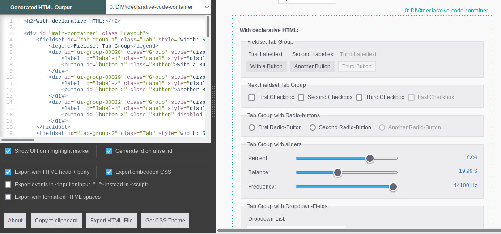

### Initialization

Just insert the JS-sourcefile into the HTML document:

```html
<script src="path/to/ui-code-console.production.min.js"></script>`
```
Add the extension into the configuration:

```js
UIFormElements.setConfig({
    userselect: false,
    theme: "SystemUI",
    extensions: [
        "UICodeConsole"
    ]
});
```

Now add the generated Form into the extension:

```js
uiParentRootNode = document.getElementById("parent-root-node");

// add the form HTML output to the document node
uiParentRootNode.appendChild(uiForm.createHTMLElement());

// add the document node to the code console
UICodeConsole.add(declarativeRootNode);
```

### Configuration options

**Show UI Form highlight marker**:
> Show or hide the dotted highlighted-marker-border around the selected UI Form in the HTML document

**Generate id on unset id**:
> Automatically generates ids for ui-elements without ids.

**Export with HTML head + body**:
> Export the HTML document with or without the html document tags (head + body).

**Export embedded CSS**:
> Export the HTML document with or without the releated embedded CSS styles.

**Export events in &lt;input oninput="..."&gt; instead in &lt;/script&gt;**:
> Exports binded events completely into the HTML tags instead as a appended script section at the bottom of the HTML document.

**Export with formatted HTML spaces**:
> Exports the HTML document with or without the formatted spaced.

*! Exporting code with HTML-spaces can cause HTML formatting problems and display issues in spacing of elements.*

<br>

### HTML and CSS export

The generated code is displayed in a text field and can be copied into the clipboard or downloaded as `*.html` document file.
The related CSS-theme-file can be downloaded as a `*.css` file.

<br>

## Buiding production files

You can build the minified production `*.js` and `*.css` files with the Node.js-builder, if you want to compile the modified source files in the `development/` folder.

### Node.js Linker and compressor

Use the `package.json` file in the Node.js program folder `development/node-js-builder/`. The CommonJS file in the configuration JSON-file uses `babel-minify`.
It merges all the JS class and program files together into single files and compresses it into minifed production files.

### Configuration and setup

Just install the dependency `babel-minify` with:

```console
npm install
```

and run the build program with:

```console
npm run build
```

You can also run build files to merge and process other `*.*` files out of the given configuration-files:

```console
node build-production-files.js config/your-own-build-config.json
```


<br>

## Development sources

https://www.w3schools.com/html/html_forms.asp
<br>
https://www.w3.org/
<br>
https://developer.mozilla.org/en-US/docs/Web/HTML/Reference/Elements
<br>
https://html.spec.whatwg.org/multipage/forms.html
<br>
https://www.chromium.org/
<br>
https://caniuse.com/
<br>

<br>


## License

**UIFormsElements.js** and **UICodeConsole.js** are licenced under *CC BY-NC-SA*.

<br>

### Third-party software

The **UICodeConsole.js** extension uses the following third-party software components:

- code-prettify (Apache licence) - https://github.com/googlearchive/code-prettify

- js-beautify-1.2.0 (MIT licence) - https://github.com/beautifier/js-beautify

- split-0.1.0 (Custom licence) - https://github.com/nathancahill/split

The **UIFormElements.js Live Editor** application uses the following third-party software components:

- Try It Editor Offline (MIT Licence / W3C ToS) - https://github.com/luce80/Try-It-Editor-Offline

- CodeMirror (MIT licence) - https://codemirror.net/

The third-party software licences are in the related folders.